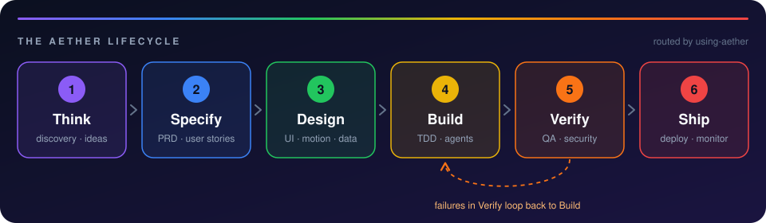

<div align="center">


# AETHER

**Reusable AI skills for modern developers — and for anyone learning to build software with AI.**

<a href="CHANGELOG.md"></a>
<a href="LICENSE"></a>
<a href="#-skills"></a>
<a href="#-installation"></a>

🟣 **Think** → 🔵 **Specify** → 🟢 **Design** → 🟡 **Build** → 🟠 **Verify** → 🔴 **Ship**

[How it works](#-how-it-works) · [Skills](#-skills) · [Installation](#-installation) · [Quick start](#-quick-start) · [Contributing](#-contributing) · [Tiếng Việt](#-tiếng-việt)

</div>

---

AETHER is a skills pack for AI coding agents — **Claude Code, Cursor, Antigravity, Codex and Gemini CLI**. It makes your agent work through the whole product lifecycle instead of jumping straight to code: check the problem, write the requirements, design the interface and its motion, build in small tested steps, verify for real, and ship safely.

> [!NOTE]
> Built on [Superpowers](https://github.com/obra/superpowers) by Jesse Vincent (MIT). Its planning, TDD, debugging and code-review skills are included. AETHER adds the skills a product needs around the code: discovery, PRD, UI/UX design, animation, architecture, harness setup, security review, visual QA and deployment.

## ✨ Why AETHER

<table>
<tr>
<td width="33%" valign="top">

**🧭 A route, not a toolbox**

`using-aether` loads at session start, works out which phase the task is in, and runs the matching skill before the agent answers.

</td>
<td width="33%" valign="top">

**🧪 Evidence over vibes**

Tests first, root-cause debugging, real screenshots and a security pass — before anything is called done.

</td>
<td width="33%" valign="top">

**📁 History in the repo**

Every skill writes to `docs/aether/`: discovery notes, PRDs, design system, ADRs, plans, QA, reviews and runbook.

</td>
</tr>
</table>

## 🧭 How it works

<p align="center">
  
</p>

1. **Session start** — a hook loads `using-aether` in every session (on harnesses that support hooks).
2. **Routing** — `using-aether` decides which phase the work is in and invokes the matching skill.
3. **Hand-off** — each skill ends by handing off to the next phase. A failure found in **Verify** loops back to **Build**.

## 🧰 Skills

24 skills across six phases. **✦** marks the 10 written for AETHER; 13 come from Superpowers, plus the `using-aether` router.

### 🟣 01 · Think — *is the problem real?*

| Skill | What it does |
|---|---|
| `problem-discovery` ✦ | Checks that the problem is real, who has it, and what the smallest useful version is — before any PRD or code. |
| `brainstorming` | Turns a rough idea into an agreed design, one question at a time. |

### 🔵 02 · Specify — *what exactly are we building?*

| Skill | What it does |
|---|---|
| `writing-prd` ✦ | One-page PRD with scope, user stories and testable acceptance criteria. |
| `writing-plans` | Breaks a spec into a step-by-step implementation plan. |

### 🟢 03 · Design — *how will it look, move and fit together?*

| Skill | What it does |
|---|---|
| `ui-ux-design` ✦ | Visual direction, design tokens, layout and accessibility rules before any UI code. |
| `motion-animation` ✦ | Animation with a purpose: consistent timing and easing, good performance, reduced-motion fallback. |
| `architecture-design` ✦ | Tech stack, data model, database schema, API contract, auth and LLM/RAG decisions, written down as ADRs. |

### 🟡 04 · Build — *small, tested steps*

| Skill | What it does |
|---|---|
| `harness-setup` ✦ | Rules files (`AGENTS.md`, `CLAUDE.md`, `.cursor/rules`), permissions, hooks and MCP servers. |
| `test-driven-development` | Red → green → refactor for every feature and bugfix. |
| `executing-plans` | Works through a plan inline, task by task. |
| `subagent-driven-development` | Hands plan tasks to subagents, with a review after each one. |
| `dispatching-parallel-agents` | Runs independent tasks in parallel. |
| `using-git-worktrees` | Gives feature work an isolated workspace. |
| `workflow-automation` ✦ | Scheduled or event-driven automations with n8n, Make, Zapier, GitHub Actions or a headless agent. |
| `writing-skills` | Creates new skills and tests them. |

### 🟠 05 · Verify — *prove it works*

| Skill | What it does |
|---|---|
| `systematic-debugging` | Finds the root cause before proposing a fix. |
| `verification-before-completion` | Runs the checks and reads the output before claiming anything is done. |
| `visual-qa` ✦ | Screenshots at phone, tablet and desktop sizes, in light and dark mode and with reduced motion. |
| `security-review` ✦ | Catches the security mistakes AI-generated code commonly makes, before the first public deploy. |
| `requesting-code-review` | Gets the work reviewed before it merges. |
| `receiving-code-review` | Checks review feedback with technical rigor instead of applying it blindly. |

### 🔴 06 · Ship — *put it online, keep it healthy*

| Skill | What it does |
|---|---|
| `deploy-and-monitor` ✦ | First deploy, releases, domains, environment variables, error tracking, rollback plan and runbook. |
| `finishing-a-development-branch` | Decides how to merge, open a PR or clean up a finished branch. |

## 📁 What you get

Every skill saves its output in your project, so the whole history of a product stays in its repo:

```text
docs/aether/
├── discovery/      problem-discovery       is the problem real, and for whom
├── specs/          brainstorming           agreed designs
├── prd/            writing-prd             one-page PRDs
├── design/         ui-ux-design, motion    design-system.md
├── architecture/   architecture-design     overview.md + ADRs
├── plans/          writing-plans           implementation plans
├── workflows/      workflow-automation     one file per automation
├── qa/             visual-qa               screenshots per feature
├── reviews/        security-review         security reviews
└── ship/           deploy-and-monitor      runbook.md
```

## 📦 Installation

Install AETHER separately for each agent you use.

<details open>
<summary><b>Claude Code</b></summary>

```bash
/plugin marketplace add lephus/AETHER
/plugin install aether@aether
```

</details>

<details>
<summary><b>Antigravity</b></summary>

```bash
agy plugin install https://github.com/lephus/AETHER
```

Run the same command again to update.

</details>

<details>
<summary><b>Cursor</b></summary>

Add this repository as a plugin from the Cursor plugin settings (or `/add-plugin`) using the URL `https://github.com/lephus/AETHER`, or clone it and point Cursor at the folder.

</details>

<details>
<summary><b>Codex</b></summary>

Clone the repo and add it as a local plugin (it ships `.codex-plugin/plugin.json` and `.agents/plugins/marketplace.json`).

</details>

<details>
<summary><b>Gemini CLI</b></summary>

```bash
gemini extensions install https://github.com/lephus/AETHER
```

</details>

<details>
<summary><b>Terminal apps (ShellX and others)</b></summary>

AETHER runs inside the CLI agent, so a terminal such as [ShellX](https://shellx.pro) needs nothing extra. Install AETHER for the agent you run there (Claude Code, Codex, Gemini CLI), and you can follow and answer the agent from your phone while it works through the lifecycle.

</details>

## ⚡ Quick start

Open your agent in an empty folder and say:

> I have an idea for an app: …

The agent should announce `problem-discovery`, ask you one question at a time, and write `docs/aether/discovery/…`. From there it hands off phase by phase.

> [!TIP]
> You can also start at any phase: *"design a landing page"*, *"add animations"*, *"set up the harness"*, *"review security"*, *"deploy this"*.

## 🗂️ Repository layout

```text
skills/<name>/SKILL.md       one folder per skill (+ scripts, references)
hooks/                       session-start hook that loads using-aether
.claude-plugin/ .cursor-plugin/ .antigravity-plugin/ .codex-plugin/ gemini-extension.json
scripts/validate-skills.sh   checks frontmatter and cross-references
scripts/sync-superpowers.sh  pulls upstream Superpowers skills and re-applies renames
docs/course-map.md           how the skills map to the 15-session "AI Vibe Coding" course
```

## 🤝 Contributing

Read [`AGENTS.md`](AGENTS.md) first. New skills follow [`skills/writing-skills/SKILL.md`](skills/writing-skills/SKILL.md): a `description` that starts with "Use when…", a clear process, red flags, and a hand-off to the next phase.

```bash
scripts/validate-skills.sh                          # must print OK
CLAUDE_PLUGIN_ROOT=$PWD bash hooks/session-start    # must print valid JSON
node --check skills/visual-qa/scripts/capture.mjs   # visual-QA script syntax
scripts/sync-superpowers.sh                         # update vendored skills, then review git diff
```

> [!IMPORTANT]
> `scripts/validate-skills.sh` must print `OK` before every commit.

## 📄 License

MIT — see [`LICENSE`](LICENSE). Superpowers attribution and the list of vendored files are in [`NOTICE.md`](NOTICE.md).

---

## 🇻🇳 Tiếng Việt

**Dành cho sinh viên học phần "AI Vibe Coding".**

AETHER là bộ skill giúp AI agent làm phần mềm theo đúng 6 bước:

| | Bước | Làm gì |
|:-:|---|---|
| 🟣 | **Think** | Kiểm chứng ý tưởng |
| 🔵 | **Specify** | Viết PRD |
| 🟢 | **Design** | Giao diện, animation, kiến trúc |
| 🟡 | **Build** | Code cùng AI |
| 🟠 | **Verify** | Test, debug, bảo mật |
| 🔴 | **Ship** | Đưa lên mạng |

**Bắt đầu:** cài theo [hướng dẫn ở trên](#-installation) cho công cụ bạn dùng (Claude Code trong ShellX, Cursor hoặc Antigravity), rồi mở agent và nói: *"Mình có ý tưởng làm app …"*.

📚 Lộ trình 15 buổi của học phần: [`docs/course-map.md`](docs/course-map.md). Mọi kết quả được lưu trong `docs/aether/`, nên giảng viên chấm được cả quá trình, không chỉ sản phẩm cuối.

<p align="center"><sub><a href="#aether">⬆ Back to top</a></sub></p>
